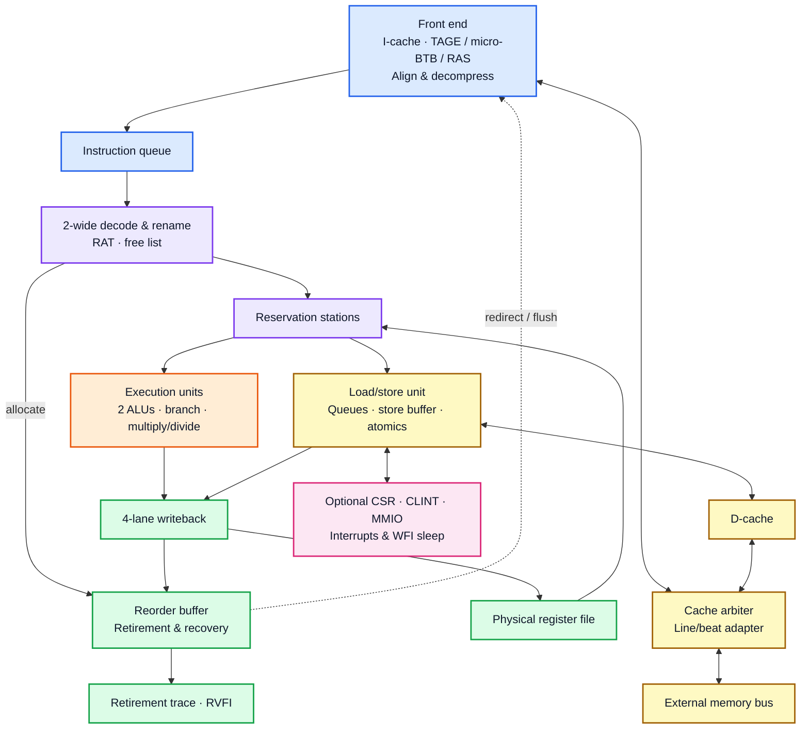

# OOOreo

OOOreo is a two-wide, out-of-order 32-bit RISC-V processor written in SpinalHDL.
It supports RV32IM with configurable C and A extensions, machine-mode CSRs,
interrupts, WFI sleep and uncached MMIO. One RTL generator supports ASIC and
Xilinx 7-series FPGA implementations.

## Processor metrics

| Physical implementation | Value |
| --- | ---: |
| Clock frequency | **601.5 MHz** |
| Cell and macro area | **0.645469 mm²** |
| Die outline | **1.21 mm²** |
| Estimated power | **320.342 mW** |
| Flip-flops | 17,250 |
| Memory/divider macros | 69 |

These values describe the included Nangate45 TT implementation at 1.1 V and
25 °C, using placement RC, placeholder macros and uniform switching activity.
They are implementation estimates, not silicon measurements. See
[measurement conditions and checks](synth/implementation/README.md).

| Default RTL resources | Configuration |
| --- | --- |
| Dispatch / integer issue / retirement | 2 instructions per cycle |
| Reorder buffer / physical registers | 32 entries / 48 registers |
| Instruction queue | 8 entries |
| Reservation stations | 12 integer, 3 multiply/divide, 3 branch, 6 memory |
| Load queue / store queue / store buffer | 4 / 4 / 2 entries |
| I-cache / D-cache | 8 KiB / 2 KiB, 4-way, 32-byte lines |
| Writeback / fast bypass | 4 lanes / 2 lanes |
| Memory interface | 32-bit address, 64-bit data |

The resource table describes the configurable source core. Generating RTL does
not recreate the physical layout above or establish its clock frequency.

## Architecture



This shows logical data and control paths, not pipeline timing. Branch and
multiply/divide share one writeback lane; the two ALUs and LSU use the other three.

## Getting started

On Ubuntu 24.04, install Java 21 and sbt, then:

```sh
git clone --depth 1 https://github.com/rishivg/OOOreo-RV32IM-Processor.git
cd OOOreo-RV32IM-Processor
scripts/install_toolchain.sh
python3 -m unittest discover -s tests
(cd hdl && sbt -batch test)
python3 bin/generate_rtl.py build/rtl
make -C sim run PROG=../testcode/dependency_test.s
```

The installer supplies Python, C++/make, Verilator, Icarus Verilog, Yosys and
RISC-V GCC. Python 3.10+ is required. The ASIC physical flow uses the pinned
ORFS container.

```sh
make -C lint lint                              # Verilog frontend checks
python3 sim/regress.py testcode/coremark_*.elf   # RVFI benchmark fixtures
make -C fpga synth                              # Xilinx synthesis
```

## Documentation

- [RTL configuration and coding conventions](hdl/README.md)
- [Tests, simulation and performance reports](docs/verification.md)
- [Source-built qualification workloads](verification/README.md)
- [FPGA implementation](fpga/README.md)
- [ASIC synthesis](synth/README.md) and [physical implementation checks](synth/implementation/README.md)
- [Memory models](sram/README.md)

`hvl/` contains simulation models and the RVFI monitor. `testcode/` contains
assembly tests and benchmark fixtures. Generated RTL, simulator builds and
reports belong in ignored output directories.

## License

Original OOOreo code is licensed under [Apache-2.0](LICENSE). See [NOTICE](NOTICE)
for third-party components and their licenses.
